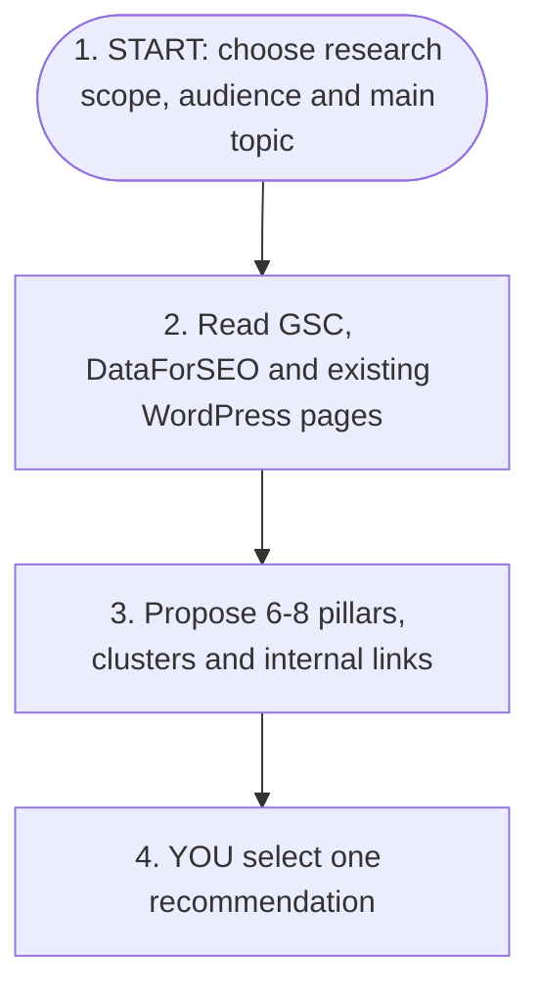
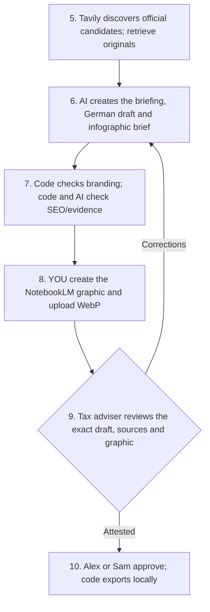
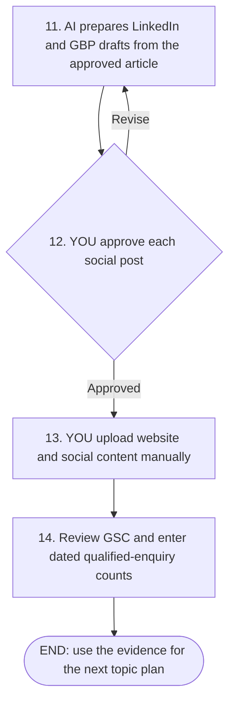

# Current workflow - version 1.2.1

Page QA receives the complete current article, metadata, approved service scope and
configured company facts. Historical website bodies remain module evidence, not
current article sections. A cross-section contradiction must identify two current
draft modules. A website omission does not disprove an approved company fact;
historical website inconsistencies require separate professional consideration.
Invalid responses remain preserved and cannot produce a QA pass or an automatic
paid replacement attempt.

QA preflight also compares the largest pending request's conservative token
reservation with the remaining run allowance before buying other units. Progress
reports that requirement, available tokens and the total pending reservation bound.
Each request still reserves atomically and settles to actual usage. Token and USD
allowances are separate; neither is increased automatically.

Before step **1**, sign in with an activated account. New registrations need administrator approval and authenticator setup. When no administrator exists, use **Set up administrator** with the local backend terminal code. Saved work appears under **My runs** or **Shared with me**; owners share explicitly with qualified professional/final reviewers. Administrators assign owners to historical runs.

Start at **1**. Every upload to WordPress, LinkedIn or Google Business Profile (GBP) is manual.

## Stage 1: choose work

A link-only selection exports recommendations and stops without drafting an article.

New portal research defaults to **Entire website**. Research scope and drafting
audience are separate: a recommendation needs a matching approved audience/service
profile before drafting. ICP1 remains available. Review **Evidence-backed** actions
separately from **Needs more research** ideas; the portal does not acknowledge open
assumptions for the user. See Search and AI visibility
for scope, tool status, observations, evidence downloads and shared campaign limits.

## Stage 2: create and approve website content

Upload requires the current `seo_check_passed` revision. Graphic creation may start earlier; the upload follows automated QA. Recalculate release blockers after attachment. The WebP must be 1200-1600 px wide, at most 3200 px high and strictly below 300,000 bytes.

Professional review uses an enabled `tax_adviser` account. The administrator checks qualifications before granting the role. Attestation records identity, time, revision and a fingerprint of the draft, evidence and graphic. Changed material needs a new attestation. Automated blockers must be resolved; a checkbox cannot bypass them.

Corrections rerun affected work and dependent checks. Saved upstream research and completed paid responses are reused where valid. Fresh paid research may be needed after expiry; an uncertain paid request is not automatically repurchased.

Semantic QA uses a versioned manifest covering page intent, every module and every registered claim. Module checks also detect tax assertions absent from the claim sheet. Claim units receive complete saved original sources in ordered text pieces. Completed, grounded unit results are reused for the same revision/evidence/model/policy; missing, repetitive, malformed or truncated results never become a pass. Professional suitability remains a human decision.

Use **Current progress** for the current revision, review-unit completion and ledger totals. Task history records earlier attempts. `GET /runs/{run_id}/progress` is authenticated and follows normal private-run access rules. Recorded/reserved amounts and reported model costs are different views; do not add them together as separate charges. Unknown amounts stay reserved, and actual provider invoices remain separately verified.

`POST /jobs` accepts `run_budget_usd` only when `kind=start`. It must be positive and no greater than the application's run limit. The allowance is saved before processing, cannot be edited later, and is enforced atomically by both storage adapters together with global run/month limits. Legacy runs without this field retain their previous limits. JSON defaults make existing checkpoints compatible; no account, approval or ledger reset is needed.

If automatic checks stop with a saved draft, the portal shows **Draft saved — corrections required**. Inspect the English findings and German preview in **Draft & Quality Checks**, then explicitly request a targeted correction when ready. This creates a revision using saved upstream work and retains existing repair/spending limits; it does not approve anything. Rechecking alone leaves the text unchanged. Missing approved prices or fee wording and professional decisions require the team. Testimonials are optional; omit them when unavailable. See [paid-call recovery](PAID_CALL_RECOVERY.md) and [failure diagnostics](FAILURE_DIAGNOSTICS.md).

For corrections that need no AI writing, open **Edit saved German draft — no AI charges** in **Draft & Quality Checks**. Edit article sections or exact claim/source quotations and save with a reason. The authenticated save creates a revision, consumes one explicit revision allowance and invalidates previous checks, infographic binding and approvals. Ownership, research and cost records remain saved. Active or uncertain work must be resolved first. Repeated submission of the same edit identifier is idempotent. Saving performs deterministic checks only; **Rerun quality checks only** is a separate, explicitly confirmed AI audit that can incur charges. Local edits never grant professional or final approval.

See team inputs and finishing checks for the remaining pricing, testimonial, personal-statement and professional-review decisions. These cannot be supplied by another AI rewrite.

## Solo evaluation (separate, unapproved)

For testing without a qualified adviser, open **Evaluate outputs — Free to open**.
Review and explicitly confirm the displayed plan before any paid requests. Inspect
the article, saved infographic, isolated social previews, English findings and
partial download. This does not complete professional review, final approval or
normal export. See Solo evaluation for tool prerequisites.

## Stage 3: prepare social content, then publish manually

Live social generation requires an approved, locally exported website revision; actual website publication is not required. Default CTAs use the existing enquiry page `/mandant-werden/`. To use the new article's URL, first publish that article manually and record its canonical URL, then change and reapprove the affected social post. A recorded URL is a manual assertion, not a reachability check.

## Roles, tools and storage

There are **seven core workflow roles**: five AI-powered roles (SEO Strategy, Topic Map, Briefing, Content, SEO QA), one rule-based Brand Check and one code-only Export/Publisher. **Social Content is an additional AI task**, producing two channel adaptations. Research summaries and page assessments can make additional model calls; role count is not API-call count. Optional image prompting/generation are disabled by default and do not replace the required manual infographic.

| Component | Purpose |
| --- | --- |
| GSC / DataForSEO / WordPress | Search performance, keyword/SERP evidence and public existing content. |
| Tavily | Official-domain candidate discovery through a direct API; snippets are not legal evidence. |
| Direct source retrieval / optional Firecrawl | Original official texts; bounded extraction fallback with approved provenance. |
| NotebookLM / Google Docs | Manual graphic creation / manual HTML-import fallback. |
| Python / FastAPI / Pydantic | Backend, authenticated API and structured contracts. |
| LangGraph / SQLite | Saved workflow stages, approval pauses, jobs, revisions and budget ledger. |
| Next.js | English operator portal with guided stages; German content/export previews remain unchanged. |
| PostgreSQL / Langfuse | Optional storage alternative / deferred monitoring, respectively. |

This is a LangGraph workflow, not CrewAI. No generic MCP runtime or automatic publishing connector is installed. Per-run and shared UTC-month reservations apply to tracked paid work.

## Preflight and attempt history

Choose the linking policy and allowance before starting. Run preflight is authenticated/read-only; it can identify missing inputs but does not retrieve them or verify provider access. Candidate guide titles are not proof of semantic relevance. Preflight is repeated in the worker before paid briefing/writing, including after official research. Unusable sources are excluded rather than silently promoted to evidence; incomplete source research remains explicit. Interrupted preflight preserves source inputs independently of a failed graph checkpoint.

Current progress presents English findings/actions, the policy, model routes, costs and nonblocking editorial follow-ups. Attempts record start/result revisions and dates; older records without revision metadata remain labelled as such. Earlier failed attempts never grant or revoke a newer revision's approvals. No refresh or stage navigation starts paid work.

## Effective draft review policy (20 October 2026)

The approved `content-review-4-optional-testimonials` policy overrides original
mandatory testimonial quantities: no reviews means no L12, hero stars or empty
review placeholders. Genuine approved reviews may be included later with correct
wording and attribution; no minimum of three applies. Original business references
remain unchanged. Pricing, infographic, professional and final approval gates remain.

The QA contract supplies the full article for page coverage and complete module
text, relevant cross-references, approved company evidence and page-specific link
rules for module checks. Tax-law assertions use official source claims; ordinary
approved services do not need tax claims. Findings distinguish blocking defects,
style suggestions and release prerequisites, with English explanations and German
quotations. Completed units are not equivalent to passing content. Only compatible
unit dependencies are reusable; the revision manifest records that reuse.

Local metadata repair only normalizes whitespace without changing meaning; it
never substitutes a generic description. Invalid complete output remains available
through encrypted recovery. No automatic paid retry is enabled.

The 21 October saved QA result is revision 5, with all 15 review units passed.
It remains unapproved; current readiness comes from saved run state. The optional-review policy does not approve content. The infographic
brief describes the article/service-page visual, not a generated image; generation,
validation and upload remain manual. It is exported with run ID and revision.

## Interpreting independent checks

A passed Brand Check is one completed stage; semantic QA may still be pending or stopped. Both Current progress and Draft & Quality Checks use the same derived check summary. An invalid AI review stops the review, not proof that the German draft is defective. Preserve that response and inspect its diagnostic before another explicitly confirmed paid attempt. Repairing the software does not convert the old response into a pass. Draft downloads remain labelled unapproved until final approval/export.

## Guided material QA and review preview (21 October 2026)

The portal uses an eight-step, permission-aware workflow projection; browsing a
step never queues work. Progress and preflight expose additive guidance and QA
readiness. See the concise user guide.

`guided-material-qa-v1` adds a read-only reviewer system, typed page/module/claim
assessments and a complete criterion list. Editorial suggestions cannot be returned
as blocking findings. Material findings require an applicable requirement and
impact; contradictions require supported passages (or original official-source
proof for claim reviews). Approved presentation-normalized wording remains under
deterministic authority. Invalid responses and their paid history remain retained,
unaccepted, and separate from content defects. The exact invalid unit dependency
is quarantined against another unchanged paid attempt, at enqueue and execution.

The authenticated read-only `GET /runs/{run_id}/review-preview?revision=N` supports
an optional `finding_id`. It highlights escaped DOM text only, retains sandbox/CSP
protections and never changes saved HTML or exports. A stale revision is rejected;
ambiguous quotations use section navigation. Diagnostics remain administrator-only.

Accepted earlier nonblocking module/claim results can be projected through an
explicit compatibility validation with recorded provenance. Historical failures
are never converted into passes. Revision 5 was preserved; its remaining semantic review subsequently passed
with separate authorization on 21 October. Presentation changes start no paid review. Infographic,
professional attestation, final approval and release checks remain enforced.

L10 reference coverage is observed deterministically from the approved fact pack.
When all three references are present, paragraph/sentence grouping is a minor
presentation suggestion, not an essential missing-module defect. Contextual
contradictions and genuinely missing references remain reviewable.

## Free local export correction — 23 October 2026

Revision 6 of the saved sole-trader example replaces missing prices with the
explicitly approved, run-only fee-wording policy and corrects old graphic notes.
Revision 5 retains its original passed checks. After explicit paid authorization on
23 October, all fifteen revision 6 checks are accepted: eleven reused and four newly reviewed. No review is purchased by
saving, opening the review package or downloading. The configured allowances
remain unchanged.

Open **Open review package — Free** in Solo evaluation. The current article and
previous-revision examples are clearly separated. Old graphics/social files never automatically satisfy new revision approvals. The
existing infographic was subsequently inspected and explicitly attached to revision 6
after QA passed; its professional review remains pending. Anna's statement
and the other unresolved release inputs remain required.

## Rehearse all eight steps without release approval

In Solo evaluation, choose **Start eight-step test — Free**. Continue through the
saved first five steps, click **Simulate professional review**, then **Simulate
final approval**, and download the unapproved test export. This separate panel
can show eight test steps completed while the real workflow waits for professional
review. Nothing publishes or purchases work. Reloading resets the rehearsal only.

## Actual internal-only workflow — 23 October 2026

The run owner or administrator may explicitly select **Use internal-review
workflow — Free**. This is a per-run alternative, not a simulation or change to
professional qualifications. The main eight-step summary then names steps 6–8
**Internal review → Final internal approval → Internal export**.

The owner inspects the article, sources, infographic and outstanding requirements,
checks the four review confirmations and enters a note. **Record my internal
review** saves identity, time and the reviewed revision/context. Next, two explicit
confirmations permit **Record my final internal approval**. **Create internally
reviewed export** writes a durable, hash-checked ZIP; download does not reapprove it.
All actions are free and remain recorded after reloading. Duplicate requests are
idempotent. Stale content, missing genuine QA/graphic or active/uncertain work block
progress. Changing policy cannot revive an older approval.

The package says **Internally reviewed — professionally unapproved**. Outstanding
business/source inputs remain visible and acknowledged; this path never certifies
those inputs or creates a professional attestation. Its records and files stay
separate from the ordinary approved exporter. Normal social preparation,
publication records and professional release gates remain unchanged. Earlier
social/image examples retain their original revision labels.

Returning to the qualified-adviser workflow preserves history and grants no new
permission. Internal-only approval never authorizes upload or publication.
